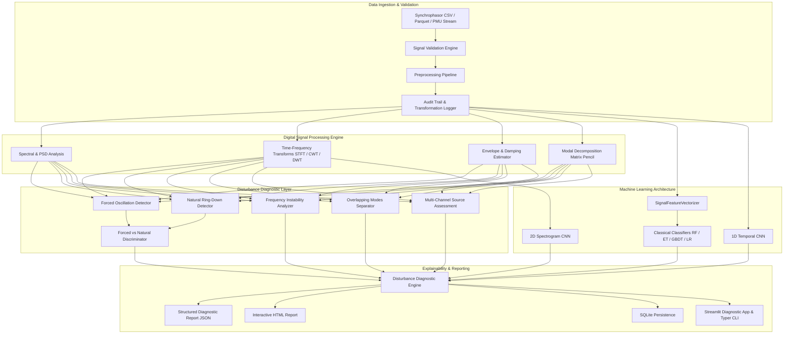

# System Architecture & Design Specification

## 1. High-Level Architecture Overview

`grid-disturbance-analysis` is structured as a decoupled, layered scientific computing engine designed for power grid synchrophasor disturbance analysis, oscillation characterization, and origin assessment.

## 2. Architectural Boundaries & Data Contracts

The architecture strictly decouples signal processing from presentation interfaces:

1. **Core Signal Processing (`grid_disturbance.signals`):**
   - Independent of Streamlit, Typer, and PyTorch. Operates strictly on NumPy arrays and SciPy algorithms.
2. **Analysis & Disturbance Logic (`grid_disturbance.analysis`):**
   - Implements power system physical domain rules (damping thresholds, persistence checks, cross-spectral coherence).
   - Distinguishes direct measurements, derived features, and model hypotheses.
3. **Machine Learning (`grid_disturbance.ml`):**
   - Consumes standardized tabular features or raw windows.
   - Enforces zero-leakage grouped splitting (`GroupShuffleSplit` on `event_id`).
4. **Diagnostic Reporting (`grid_disturbance.reporting`):**
   - Produces strictly validated Pydantic models (`StructuredDiagnosticReport`).
5. **Persistence (`grid_disturbance.storage`):**
   - Self-contained SQLite database for persistent analysis history.
6. **Interfaces (`grid_disturbance.cli` and `grid_disturbance.app`):**
   - Thin presentation layers delegating to core packages.
