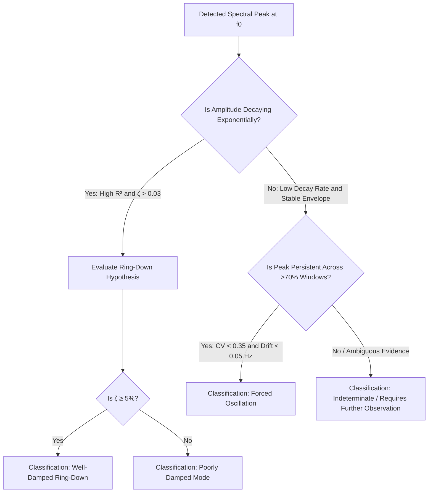

# Disturbance Classification & Taxonomy

## 1. Physical Disturbance Categories

Power grid oscillations originate from distinct underlying physical mechanisms. The system characterizes and differentiates the following taxonomy:

| Class Key             | Disturbance Name    | Frequency Range | Physical Mechanism                                                                                | Persistence Behavior                                    |
| :-------------------- | :------------------ | :-------------- | :------------------------------------------------------------------------------------------------ | :------------------------------------------------------ |
| `forced_oscillation`  | Forced Oscillation  | 0.05 – 10.0 Hz  | Continuous periodic external input (malfunctioning governor, cycling load, inverter control loop) | Sustained indefinitely until source is isolated         |
| `damped_ringdown`     | Natural Ring-Down   | 0.1 – 2.0 Hz    | Impulse/step response following grid disturbance (fault, trip, switching); well-damped            | Decays exponentially (\(\zeta \ge 5\%\))                |
| `poorly_damped`       | Poorly Damped Mode  | 0.1 – 1.8 Hz    | Inter-area or local plant mode with insufficient damping                                          | Decays very slowly (\(0 < \zeta < 3\%\))                |
| `growing_oscillation` | Growing Oscillation | 0.2 – 2.0 Hz    | Dynamic negative damping instability                                                              | Exponential amplitude growth (\(\alpha < 0\))           |
| `frequency_excursion` | Frequency Excursion | DC / Transient  | Significant generation-load active power deficit / surplus                                        | High RoCoF (\(df/dt\)), nadir/zenith, governor recovery |
| `overlapping_events`  | Overlapping Modes   | Multiple bands  | Concurrent physical disturbances (e.g., 0.3 Hz inter-area + 1.2 Hz forced)                        | Multi-peak spectral decomposition                       |
| `baseline_noise`      | Ambient Grid Noise  | Broadband       | Small random load switching and ambient colored measurement noise                                 | Stationary ambient variance                             |

---

## 2. Discrimination Logic: Forced vs. Natural Oscillations

### 2.1 Forced Oscillation Signatures

- **Persistence Ratio:** Dominant frequency must be detectable in \(\ge 70\%\) of sliding time windows.
- **Spectral Concentration:** High purity (\(\ge 0.40\)) with narrow peak width.
- **Envelope Stability:** Low coefficient of variation (\(CV \le 0.35\)) over observation windows.
- **Frequency Stability:** Frequency variation \(\Delta f \le 0.05\text{ Hz}\).
- **Harmonics:** Often exhibits integer multiple harmonic peaks (\(2f_0, 3f_0\)) from non-linear actuator limits.

### 2.2 Natural Ring-Down Signatures

- **Envelope Decay:** Fits exponential envelope \(A e^{-\alpha t}\) with high goodness-of-fit (\(R^2 \ge 0.50\)).
- **Measurable Damping Ratio:** Positive damping ratio (\(\zeta > 0\)).
- **Attenuation Ratio:** Amplitude ratio between the last quarter and first quarter of signal window drops significantly (\(\le 0.35\)).

### 2.3 Indeterminate Class Policy

Signals that display ambiguous features (neither stationary persistence nor measurable decay) are explicitly classified as **Indeterminate** rather than forcing an unsupported binary prediction.
