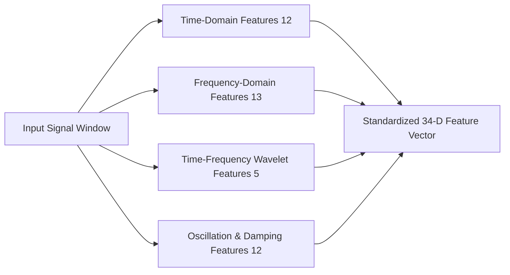
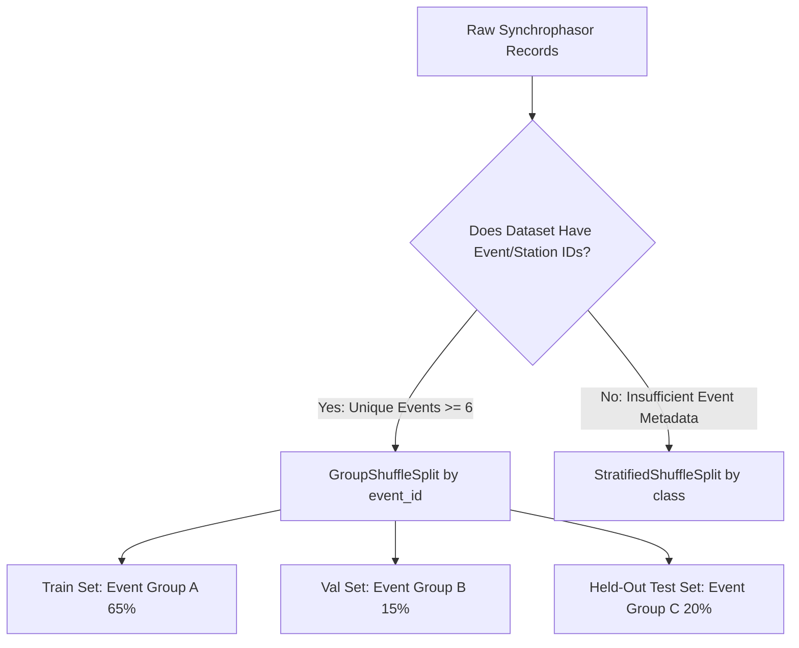

# Machine Learning Architecture & Methodology

## 1. Feature Engineering Specification

The feature engineering layer extracts a 34-dimensional tabular representation from each 1D time-series window:

### Feature Categories:

1. **Time-Domain (`td_*`):** Mean, standard deviation, variance, RMS, peak-to-peak amplitude, crest factor, skewness, kurtosis, zero-crossing rate, total energy, autocorrelation lag-1, autocorrelation peak.
2. **Frequency-Domain (`fd_*`):** Dominant frequency, dominant peak power, peak prominence, peak width, peak count, spectral centroid, spectral bandwidth, spectral entropy, spectral flatness (Wiener entropy), spectral concentration, inter-area band energy ratio (0.1–1.0 Hz), local plant band ratio (1.0–2.0 Hz), sub-synchronous band ratio (2.0–10.0 Hz), harmonic indicator.
3. **Time-Frequency (`tf_*`):** DWT multiresolution wavelet relative energies (Approximation + Detail levels 1–4).
4. **Oscillation Specific (`osc_*`):** Damping ratio (\(\zeta\)), damping coefficient (\(\alpha\)), decay rate, growth rate, envelope coefficient of variation, exponential fit \(R^2\), fit RMSE, fit confidence, amplitude modulation index, frequency drift (\(\Delta f\)).

---

## 2. Model Architectures

### 2.1 Classical Ensemble & Linear Baselines

- **Random Forest Classifier:** 150 balanced trees with bootstrap aggregation.
- **Extra Trees Classifier:** Extremely randomized trees with lower variance on noisy synchrophasor features.
- **Gradient Boosted Decision Trees:** Sequential boosting with shrinkage (learning rate 0.1, depth 5).
- **L2-Regularized Logistic Regression:** Linear baseline with balanced class weights.
- **Support Vector Machine (RBF kernel):** Margin maximization with Platt scaling for probability calibration.

### 2.2 1D Temporal CNN

- **Input:** Raw or minimally filtered 1D signal window \((1, L)\) (e.g. \(L = 600\) for 20 seconds at 30 Hz).
- **Architecture:**
  - 4 convolutional blocks: `Conv1D(k=7, 5, 3, 3)` \(\to\) `BatchNorm1D` \(\to\) `ReLU` \(\to\) `MaxPool1D(p=2)` \(\to\) `Dropout(0.3)`.
  - Feature channels: 32 \(\to\) 64 \(\to\) 128 \(\to\) 256.
  - Global Average Pooling: `AdaptiveAvgPool1D(1)`.
  - Classification head: `Linear(256, 128)` \(\to\) `ReLU` \(\to\) `Dropout(0.3)` \(\to\) `Linear(128, num_classes)`.

### 2.3 2D Spectrogram CNN

- **Input:** 2D STFT power spectrogram or CWT scalogram image \((1, 64, 64)\).
- **Architecture:**
  - 3 convolutional blocks: `Conv2D(3x3)` \(\to\) `BatchNorm2D` \(\to\) `ReLU` \(\to\) `MaxPool2D(2x2)` \(\to\) `Dropout(0.25)`.
  - Feature channels: 32 \(\to\) 64 \(\to\) 128.
  - Global Average Pooling: `AdaptiveAvgPool2D((1, 1))`.
  - Linear classifier with Dropout.

---

## 3. Data Leakage Prevention & Split Strategy

To eliminate data leakage:

- Overlapping windows and multi-station recordings from the **same physical disturbance event** (`event_id`) are never distributed across train and test sets.
- Feature scalers (`StandardScaler`) are fit **strictly on the training partition** and applied to validation and test sets.
