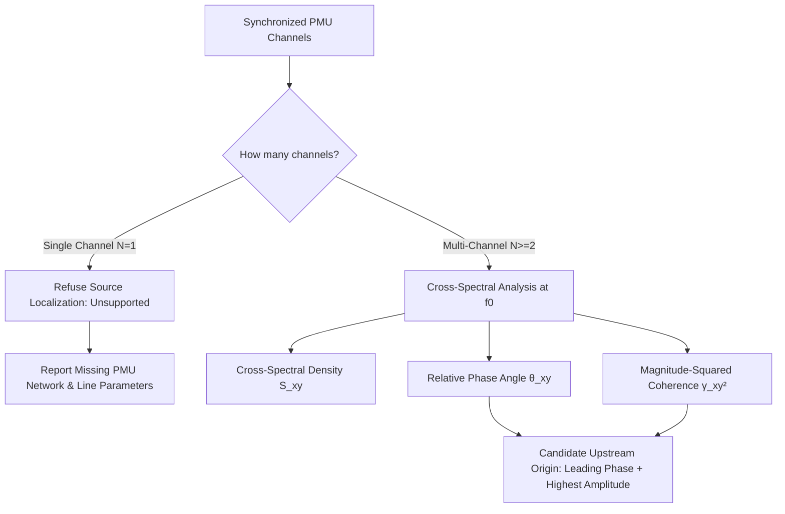

# Oscillation Source Localization & Origin Assessment

## 1. Physical Principle & Capability Boundaries

Source assessment determines whether available synchrophasor measurements provide credible evidence regarding the spatial origin or direction of a power grid disturbance.

The architecture strictly distinguishes three capability levels:

1. **Signal-Level Characterization:** Describing local frequency, amplitude, and damping behavior at a measurement bus.
2. **Source-Direction / Regional Assessment:** Establishing relative upstream vs downstream phase relationships across multiple measurement stations.
3. **Physical Equipment Attribution:** Identifying a specific generator, governor valve, or inverter hardware unit. (Requires internal generator telemetry, which is not present in pure PMU datasets).

---

## 2. Mathematical Methodology

### 2.1 Cross-Spectral Density & Phase Angle

For reference channel \(x(t)\) (station with maximum oscillation amplitude) and candidate channel \(y(t)\):

\[
S*{xy}(f) = \sum*{m=-\infty}^{\infty} R\_{xy}[m] e^{-j 2\pi f m}
\]

The phase difference between stations at disturbance frequency \(f_0\) is:

\[
\theta*{xy}(f_0) = \arg\left(S*{xy}(f*0)\right) = \arctan\left(\frac{\text{Im}(S*{xy})}{\text{Re}(S\_{xy})}\right)
\]

### 2.2 Magnitude-Squared Coherence

Coherence measures the linear correlation between channels at specific frequency \(f\):

\[
\gamma*{xy}^2(f) = \frac{|S*{xy}(f)|^2}{S*{xx}(f) S*{yy}(f)}, \quad 0 \le \gamma\_{xy}^2(f) \le 1
\]

- Only channels with \(\gamma\_{xy}^2(f_0) \ge 0.60\) are considered physically coupled in the same oscillatory event.
- Uncorrelated channels with low coherence are flagged as independent ambient noise or separate local modes.

### 2.3 Physical Origin Interpretation

In power systems subject to forced oscillations:

- The generator or substation nearest the forced oscillation driving source exhibits the **largest oscillation amplitude** and **leads in phase** relative to receiving network buses.
- Downstream load centers and remote buses display increasing phase lag (\(\theta < 0\)) due to inductive transmission line reactance.

### 2.4 Single-Channel Limitation Refusal

If only a single measurement channel is provided, the system explicitly returns:

- `is_supported = False`
- `candidate_source_channel = None`
- Explicit documentation that physical origin assessment cannot be performed without multichannel synchronized observations.
